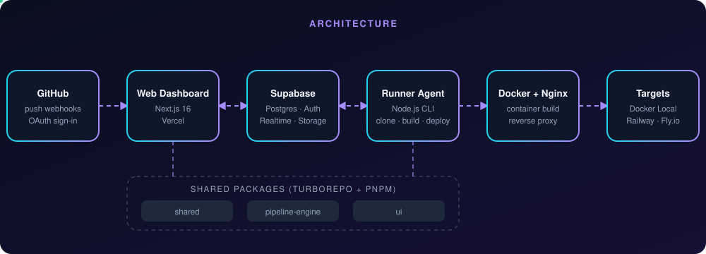

<div align="center">



<br/>

[](https://deployx-chi.vercel.app)
[](#-license)


**Define pipelines in YAML. Run them as DAGs. Ship with blue-green, canary or rolling deploys. Let the platform heal itself.**

[Features](#-features) · [How it works](#-how-it-works) · [Architecture](#-architecture) · [Quick start](#-quick-start) · [Docs](#-documentation)

</div>


## ✨ Features

| | | |
|:--|:--|:--|
| 🧩 **YAML Pipelines**<br/>Define build, test and deploy tasks with DAG dependencies | 🚦 **Multi-Strategy Deployments**<br/>Blue-green, canary (staged traffic) and rolling updates | 🩺 **Self-Healing**<br/>Automatic health monitoring, restart cascades and rollback |
| 📡 **Real-Time Observability**<br/>Live logs, DAG visualization, SLA tracking and build prediction | 🔗 **GitHub Webhooks**<br/>Auto-trigger pipelines on push with branch filtering | ⏰ **Scheduled Triggers**<br/>Cron-based pipeline execution with timezone support |
| 🔐 **Secrets Management**<br/>AES-256-GCM encrypted project secrets | 👥 **Team Management**<br/>RBAC with Owner, Admin, Developer and Viewer roles | 🎯 **Multi-Target**<br/>Deploy to Docker Local, Railway or Fly.io |


## ⚙️ How it works

Pipelines are parsed from YAML, resolved into a dependency graph, and executed by a state machine. Tasks that do not depend on each other run in parallel, and each stage advances as soon as its dependencies finish.

<div align="center">

</div>

### 🚀 Deployment strategies

Choose how a new release reaches users. Health checks gate the rollout, and self-healing can restart or roll back automatically.

<div align="center">

</div>


## 🏗️ Architecture

The control plane (Next.js) lives on Vercel, state and auth live in Supabase, and a Node.js runner agent executes pipelines: it clones, builds and deploys. The runner connects to whatever URL is provided during registration, so it works for both local and production setups.

<div align="center">

</div>

### 🧰 Tech stack

| Layer | Technology |
|:--|:--|
| 🖥️ Dashboard | Next.js 16 (App Router) |
| 🗄️ Database & Auth | Supabase (Postgres, Auth, Realtime, Storage) |
| 🏃 Pipeline Runner | Node.js CLI agent |
| 🐳 Deployments | Docker, Nginx reverse proxy |
| 📦 Monorepo | Turborepo + pnpm workspaces |

### 📁 Project structure

```
deployx/
├── apps/
│   ├── web/                    # Next.js dashboard (UI, API routes, webhooks)
│   └── runner/                 # Pipeline executor (clones, builds, deploys)
├── packages/
│   ├── shared/                 # Validators, types, constants, crypto
│   ├── pipeline-engine/        # YAML parser, DAG resolver, state machine
│   └── ui/                     # Shared UI components
├── supabase/                   # Migrations, seed data, config
├── examples/
│   └── demo-app/               # Reference app for testing DeployX
└── docs/context/               # Architecture documentation (18+ docs)
```


## 🚀 Quick start

**Prerequisites:** Node.js 20+ · pnpm 9+ · Docker Desktop · Supabase CLI (`npx supabase`)

```bash
# 1. Clone and install
git clone <repo-url>
cd deployx
pnpm install

# 2. Start Supabase (local)
npx supabase start

# 3. Configure environment
cp apps/web/.env.example apps/web/.env.local
# Fill in Supabase URL, anon key, and GitHub OAuth credentials

# 4. Run migrations
npx supabase db push

# 5. Start development
pnpm dev
```

The dashboard runs at `http://localhost:3000` during local development. The hosted version is live at **[deployx-chi.vercel.app](https://deployx-chi.vercel.app)**.

<details>
<summary><b>🔑 Environment variables</b></summary>

<br/>

| Variable | Description |
|:--|:--|
| `NEXT_PUBLIC_SUPABASE_URL` | Supabase project URL |
| `NEXT_PUBLIC_SUPABASE_ANON_KEY` | Supabase anonymous key |
| `SUPABASE_SERVICE_ROLE_KEY` | Supabase service role key (server-only) |
| `DEPLOYX_SECRET_KEY` | Secret key for AES-256-GCM encryption (secrets, GitHub tokens, webhooks) |

</details>

<details>
<summary><b>☁️ Deploying the control plane (Vercel + Supabase)</b></summary>

<br/>

The control plane (Next.js web app) is deployed to **Vercel** at [deployx-chi.vercel.app](https://deployx-chi.vercel.app).

**Vercel environment variables.** Set these in the Vercel Dashboard under *Project Settings > Environment Variables*:

| Variable | Description |
|:--|:--|
| `NEXT_PUBLIC_SUPABASE_URL` | Supabase project URL |
| `NEXT_PUBLIC_SUPABASE_ANON_KEY` | Supabase anonymous key |
| `SUPABASE_SERVICE_ROLE_KEY` | Supabase service role key |
| `DEPLOYX_SECRET_KEY` | Encryption key for secrets, GitHub tokens, and webhook signatures |

**Supabase Auth configuration.** For production, add the following under *Authentication > URL Configuration*:

- **Site URL:** `https://deployx-chi.vercel.app`
- **Redirect URLs:** `https://deployx-chi.vercel.app/auth/callback`

> The runner agent connects to whatever URL is provided during registration. The Register Runner dialog uses `window.location.origin`, so it automatically generates the correct `--url` flag for both local and production environments.

</details>

### 🧪 Demo

A working demo app is included at `examples/demo-app/`. It demonstrates all DeployX contracts:

```bash
cd examples/demo-app
npm install && npm test   # Run contract tests
npm start                 # Start locally on port 3000
```

See [examples/demo-app/README.md](examples/demo-app/README.md) for step-by-step usage with DeployX.


## 📚 Documentation

All architecture docs live in [`docs/context/`](docs/context/).

<details open>
<summary><b>Browse all 20 docs</b></summary>

<br/>

| Doc | Topic |
|:--|:--|
| [01-project-overview](docs/context/01-project-overview.md) | Architecture & tech stack |
| [02-auth-setup](docs/context/02-auth-setup.md) | OAuth, protected routes |
| [03-pages-and-routes](docs/context/03-pages-and-routes.md) | Complete route map |
| [04-database-schema](docs/context/04-database-schema.md) | 17+ tables, RLS, enums |
| [05-crud-wiring](docs/context/05-crud-wiring.md) | Data flow, server actions |
| [06-pipeline-engine](docs/context/06-pipeline-engine.md) | YAML parser, DAG, state machine |
| [07-container-factory](docs/context/07-container-factory.md) | Docker build, variable interpolation |
| [08-orchestrator](docs/context/08-orchestrator.md) | Blue-green deployment, nginx, health checks |
| [09-self-healing](docs/context/09-self-healing.md) | Health monitor, remediation, auto-rollback |
| [10-observability](docs/context/10-observability.md) | DAG visualization, live logs, metrics |
| [11-secrets-and-actions](docs/context/11-secrets-and-actions.md) | Encryption, cancel/approve actions |
| [12-roadmap](docs/context/12-roadmap.md) | Phase overview, dependency graph |
| [13-team-management](docs/context/13-team-management.md) | RBAC, invites, permissions |
| [14-webhook-triggers](docs/context/14-webhook-triggers.md) | GitHub push events, HMAC verification |
| [15-scheduled-triggers](docs/context/15-scheduled-triggers.md) | Cron execution, scheduling |
| [16-canary-rolling](docs/context/16-canary-rolling.md) | Canary/rolling strategies |
| [17-external-deployers](docs/context/17-external-deployers.md) | Railway & Fly.io integration |
| [18-advanced-observability](docs/context/18-advanced-observability.md) | SLA, alerts, notifications, audit |
| [19-getting-started](docs/context/19-getting-started.md) | Step-by-step user guide |
| [20-ui-security-fixes](docs/context/20-ui-security-fixes.md) | Recent UI & security patches |

</details>

## 📄 License

Released under the **MIT** License.

<div align="center">

<br/>

Built by [Yug Rokadia](https://github.com/YugRokadia) · If DeployX is useful to you, consider leaving a ⭐

</div>
